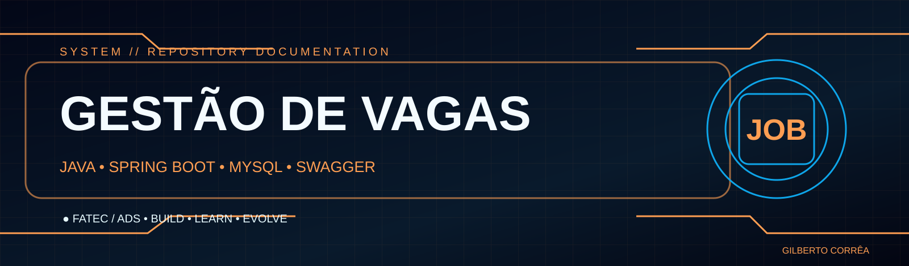
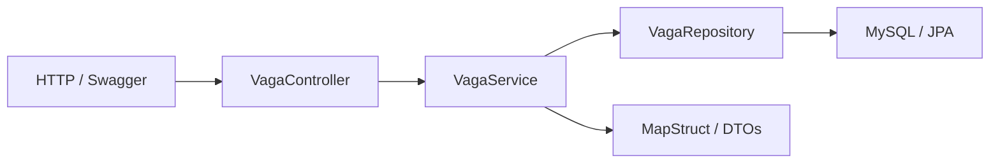

<div align="center">
  
</div>

<div align="center">

# G E S T Ã O　D E　V A G A S　//　A P I

### `JAVA 17 • SPRING BOOT 4.1.1 • MYSQL • SWAGGER`

**API REST de gerenciamento de vagas de emprego: cadastro, listagem paginada, consulta por ID, atualização e exclusão, com JPA, DTOs, MapStruct e Swagger.**


`GILBERTO CORRÊA` · `SOFTWARE ENGINEERING` · `PROJECT DOCUMENTATION`

[Visão geral](#visao-geral) · [Recursos](#recursos) · [Arquitetura](#arquitetura) · [Execução](#execucao)

</div>

---

<a id="visao-geral"></a>

## `PROJECT // VISÃO GERAL`

API REST de gerenciamento de vagas de emprego: cadastro, listagem paginada, consulta por ID, atualização e exclusão, com JPA, DTOs, MapStruct e Swagger.

<a id="recursos"></a>

## `SYSTEM // INVENTÁRIO`

| Recurso | Situação |
| :--- | :--- |
| CRUD de vagas | `Rotas documentadas` |
| Persistência MySQL / JPA | `Configurada no código` |
| DTOs e MapStruct | `Presentes` |
| Swagger/OpenAPI | `Dependência configurada` |

## `STRUCTURE // ORGANIZAÇÃO`

- `controller/VagaController.java` — rotas `/api/vagas`
- `service/VagaService.java` — operações e regras
- `repository/VagaRepository.java` — persistência
- `mapper/VagaMapper.java` — conversão
- `dto/` e `exception/` — contratos e erros

<a id="arquitetura"></a>

## `ARCHITECTURE // FLUXO DO PROJETO`



<a id="execucao"></a>

## `BOOT SEQUENCE // EXECUÇÃO OU UTILIZAÇÃO`

```bash
git clone https://github.com/gilbertocorrea-cmd/gestao-vagas.git
cd gestao-vagas
```

Use Java 17, MySQL e o Maven Wrapper do projeto. Configure a conexão com o banco conforme o ambiente e inicie com `./mvnw spring-boot:run` (Linux) ou `mvnw.cmd spring-boot:run` (Windows). Confira as requisições na seção de endpoints preservada abaixo.

---

## `DOCUMENTATION // REFERÊNCIA TÉCNICA ORIGINAL`

---

## 📌 Sobre o projeto

Este projeto consiste em uma **API RESTful para gerenciamento de vagas de emprego**, desenvolvida com **Java e Spring Boot**.

A aplicação foi construída utilizando arquitetura em camadas, separando responsabilidades entre:

```text
Controller
    ↓
Service
    ↓
Repository
    ↓
Banco de Dados
```

O projeto utiliza **Spring Data JPA** para persistência de dados, **DTOs** para transferência de informações, **MapStruct** para conversão entre objetos, **Jakarta Validation** para validação das requisições e **Swagger/OpenAPI** para documentação da API.

---

## ⚙️ Tecnologias utilizadas

| Tecnologia | Utilização |
| --- | --- |
| Java 17 | Linguagem principal |
| Spring Boot 4.1.1 | Framework da aplicação |
| Spring Web | Criação dos endpoints REST |
| Spring Data JPA | Persistência de dados |
| MySQL | Banco de dados |
| Hibernate | ORM |
| Maven | Gerenciamento de dependências |
| Lombok | Redução de código repetitivo |
| MapStruct | Conversão entre Entity e DTO |
| Jakarta Validation | Validação de dados |
| Swagger / OpenAPI | Documentação da API |

---

## 🏗️ Arquitetura

O projeto segue uma arquitetura em camadas:

```text
Cliente HTTP / Swagger / Postman
              │
              ▼
        Controller
              │
              ▼
           Service
              │
              ▼
         Repository
              │
              ▼
        MySQL / JPA
```

### Responsabilidade das camadas

- **Controller**: recebe as requisições HTTP.
- **Service**: contém as regras de negócio.
- **Repository**: realiza o acesso ao banco de dados.
- **Entity**: representa a tabela do banco.
- **DTO**: transporta os dados entre cliente e aplicação.
- **Mapper**: converte Entity ↔ DTO.
- **Exception Handler**: centraliza o tratamento de erros.

---

## 📁 Estrutura do projeto

```text
src/main/java/com/lab/jpa/gestaovagas/
│
├── config/
│   └── SwaggerConfig.java
│
├── controller/
│   └── VagaController.java
│
├── domain/
│   └── model/
│       └── Vaga.java
│
├── dto/
│   ├── VagaRequestDTO.java
│   └── VagaResponseDTO.java
│
├── exception/
│   ├── ErrorResponse.java
│   ├── GlobalExceptionHandler.java
│   └── ResourceNotFoundException.java
│
├── mapper/
│   └── VagaMapper.java
│
├── repository/
│   └── VagaRepository.java
│
├── service/
│   └── VagaService.java
│
└── GestaoVagasApplication.java
```

---

## 🧩 Entidade Vaga

A entidade principal da aplicação representa uma vaga de emprego.

Principais atributos:

```text
id
titulo
descricao
salario
dataCriacao
```

O identificador utiliza **UUID** e a data de criação é preenchida automaticamente antes do registro ser salvo.

---

## 🌐 Endpoints

A API utiliza o caminho base:

```text
/api/vagas
```

| Método | Endpoint | Função |
| --- | --- | --- |
| `POST` | `/api/vagas` | Criar uma nova vaga |
| `GET` | `/api/vagas` | Listar vagas com paginação |
| `GET` | `/api/vagas/{id}` | Buscar uma vaga pelo ID |
| `PUT` | `/api/vagas/{id}` | Atualizar uma vaga |
| `DELETE` | `/api/vagas/{id}` | Excluir uma vaga |

---

## ➕ Criar uma vaga

### Requisição

```http
POST /api/vagas
Content-Type: application/json
```

```json
{
  "titulo": "Desenvolvedor Java Sênior",
  "descricao": "Atuação em microsserviços com Spring Boot e Cloud",
  "salario": 14000.00
}
```

### Resposta

```json
{
  "id": "7f8b9c0d-1234-5678-9abc-def012345678",
  "titulo": "Desenvolvedor Java Sênior",
  "descricao": "Atuação em microsserviços com Spring Boot e Cloud",
  "salario": 14000.0,
  "dataCriacao": "2026-08-26T16:00:00"
}
```

---

## 📋 Listar vagas

```http
GET /api/vagas
```

A listagem possui suporte a **paginação e ordenação**.

Exemplo:

```text
/api/vagas?page=0&size=5&sort=salario,desc
```

---

## 🔎 Buscar vaga por ID

```http
GET /api/vagas/{id}
```

Exemplo:

```text
/api/vagas/7f8b9c0d-1234-5678-9abc-def012345678
```

---

## ✏️ Atualizar vaga

```http
PUT /api/vagas/{id}
```

Exemplo de corpo:

```json
{
  "titulo": "Desenvolvedor Backend Java",
  "descricao": "Desenvolvimento de APIs REST com Spring Boot",
  "salario": 9000.00
}
```

---

## 🗑️ Excluir vaga

```http
DELETE /api/vagas/{id}
```

Quando a exclusão é realizada com sucesso, a API retorna:

```text
HTTP 204 No Content
```

---

## ✅ Validação

Os dados recebidos pela API são validados antes de serem processados.

Exemplo de requisição inválida:

```json
{
  "titulo": "",
  "salario": -500
}
```

A API retorna um erro `400 Bad Request`.

Exemplo:

```json
{
  "status": 400,
  "error": "Erro de validação",
  "message": {
    "titulo": "O título é obrigatório.",
    "salario": "O salário deve ser um valor positivo."
  },
  "path": "/api/vagas"
}
```

---

## ⚠️ Tratamento de erros

A aplicação possui tratamento global de exceções utilizando:

```java
@RestControllerAdvice
```

Principais respostas tratadas:

| Código | Situação |
| --- | --- |
| `400` | Dados inválidos |
| `404` | Vaga não encontrada |
| `500` | Erro interno do servidor |

---

## 🗄️ Banco de dados

A aplicação está configurada para utilizar:

```text
MySQL
```

Banco:

```text
db_vagas
```

Configuração principal:

```properties
spring.datasource.url=jdbc:mysql://localhost:3306/db_vagas?createDatabaseIfNotExist=true&useSSL=false&allowPublicKeyRetrieval=true&serverTimezone=UTC

spring.datasource.username=root
spring.datasource.password=root

spring.jpa.hibernate.ddl-auto=update
spring.jpa.show-sql=true
spring.jpa.properties.hibernate.format_sql=true
```

O Hibernate cria ou atualiza automaticamente a estrutura da tabela de acordo com a entidade Java.

---

## 📖 Swagger UI

A API possui documentação interativa através do Swagger.

Após iniciar a aplicação, acesse:

```text
http://localhost:8080/swagger-ui.html
```

Documentação OpenAPI:

```text
http://localhost:8080/v3/api-docs
```

---

## ▶️ Como executar

Clone o repositório:

```bash
git clone https://github.com/gilbertocorrea-cmd/gestao-vagas.git
```

Entre na pasta:

```bash
cd gestao-vagas
```

Execute:

```bash
./mvnw spring-boot:run
```

Ou:

```bash
mvn spring-boot:run
```

A aplicação será iniciada em:

```text
http://localhost:8080
```

---

## 🧪 Testando a API

Você pode utilizar:

```text
Swagger UI
Postman
Insomnia
cURL
```

Exemplo via cURL:

```bash
curl -X POST http://localhost:8080/api/vagas \
-H "Content-Type: application/json" \
-d '{
  "titulo": "Desenvolvedor Java Sênior",
  "descricao": "Atuação em microsserviços com Spring Boot e Cloud",
  "salario": 14000.00
}'
```

---

## 🎯 Conceitos aplicados

```text
API REST
Arquitetura em Camadas
Spring Boot
Spring Data JPA
Hibernate
DTO
MapStruct
Validation
Exception Handling
Paginação
UUID
Swagger / OpenAPI
MySQL
```

---

<div align="center">

## 👨‍💻 Autor

**Gilberto Correa && Thiago Cattozzi** 

Análise e Desenvolvimento de Sistemas  
FATEC

Backend • Java • Spring Boot

[GitHub](https://github.com/gilbertocorrea-cmd)

</div>

---

<div align="center">

## `GESTAO VAGAS // BUILD • LEARN • EVOLVE`

**Gilberto Corrêa**

[GitHub](https://github.com/gilbertocorrea-cmd)

</div>
